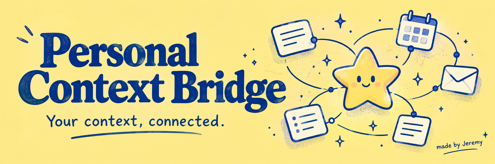
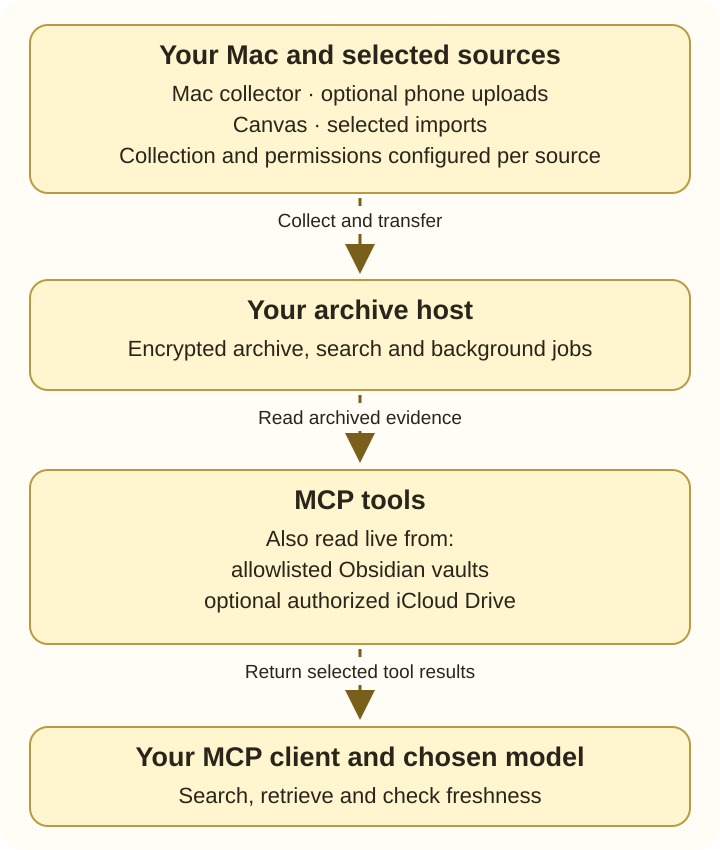

<p align="center">
  
</p>

<h1 align="center">Personal Context Bridge</h1>

<p align="center">
  A little bridge between your digital life and your AI.<br>
  Self-hosted MCP tools for your own encrypted personal context.<br>
  <a href="https://github.com/jeremydevv">Made by Jeremy</a> ✦
</p>

<p align="center">
  <a href="https://github.com/jeremydevv/personal-context-bridge/actions/workflows/ci.yml"></a>
  <a href="pyproject.toml"></a>
  <a href="LICENSE"></a>
  <a href="NOTICE"></a>
</p>

<p align="center">
  <a href="#quickstart">Try the demo</a> ·
  <a href="#pick-your-sources">Connect a source</a> ·
  <a href="docs/TOOLS.md">Every MCP tool</a> ·
  <a href="docs/PRIVACY.md">Privacy</a> ·
  <a href="CONTRIBUTING.md">Contribute</a>
</p>

## Set up with your AI

> **Copy this prompt into a coding agent with terminal access to your computer.**
> It can handle installation and guide you through connecting your own sources.

```text
Set up https://github.com/jeremydevv/personal-context-bridge for me: read its current README, docs/SETUP.md and docs/PRIVACY.md, check my platform, clone or safely update the development branch without overwriting local changes, install supported dependencies, keep credentials and encrypted runtime data outside the checkout, ask which sources I want, guide me through their supported authentication and device permissions using real setup links where available, configure my MCP client and supported sync jobs, and verify each selected source with a successful read and its latest collection time; explain anything blocked, and show me how to check for and safely apply future updates while preserving my configuration and archive. Never ask me to paste credentials into chat.
```

The agent follows the current repository instructions, so this prompt stays small
as setup improves. Installation currently uses the CLI and source-specific guides;
a unified browser setup wizard and automatic updater are not implemented yet.
Source connections require your consent, and some need macOS or phone permissions.
ChatGPT web alone cannot install local software; connect an installation through
[the ChatGPT setup guide](docs/CHATGPT.md), or use a local coding agent first.

Your notes, calendar, messages and saved ideas already tell a story. This project
helps an MCP client find the relevant pieces, read the original evidence, and
check when each source was last collected.

I’m building it to make personal context useful across conversations, with a
private archive you run yourself. Bring your own accounts, devices and MCP client;
the repository contains reusable code, templates and fictional examples.

## What it does

- **Find the original.** Search records and retrieve bounded text, attachments,
  transcript passages, PDF pages or video frames where supported.
- **Connect your own sources.** Choose Apple apps, Canvas, Health, travel,
  Obsidian, Saved videos and optional native-tag-guarded iCloud Drive access.
- **Keep an encrypted archive.** SQLCipher protects databases; AES-GCM protects
  binary attachments. Keys and runtime state stay outside the checkout.
- **Check freshness.** Source timestamps distinguish archived information from
  current device state. Archived records remain readable while collectors sleep.
- **Choose optional actions.** Native Calendar/Reminders editing, Mail sending,
  Obsidian writes and iCloud Drive organization need their own configuration and
  client approval policy.

## Quickstart

Start on **Linux with Python 3.11+**, Git and [uv](https://docs.astral.sh/uv/).
No account connection is needed for this fictional demo.

```sh
git clone https://github.com/jeremydevv/personal-context-bridge.git
cd personal-context-bridge
uv venv --python 3.11
uv pip install -e '.[mcp,messages,images]'
.venv/bin/personal-context-setup --demo
```

1. Open the generated private `mcp.json` under
   `~/.local/share/personal-context-bridge/runtime`.
2. Copy its `mcpServers` entries into your MCP client configuration and restart
   the client. The generated paths point to your own interpreter and archive.
3. Ask: **“Search my personal context for fictional.”** Expect three clearly
   fictional Calendar, Reminder and Notes records.

Setup creates a random 32-byte key and encrypted databases, refuses to overwrite
an installation, and keeps runtime state outside source. Use a separate
`--root /absolute/private/real-context` without `--demo` for real collection.
Add `--iphone` if you want empty Health/travel archives and receiver credentials.

<details>
<summary>Using pip, or choosing a different platform?</summary>

Replace the two uv commands with `python3 -m venv .venv` and
`.venv/bin/pip install -e '.[mcp,messages,images]'`. Ubuntu may need the matching
`python3-venv` package. Install from source; there is no published PyPI package.

Apple collection requires macOS. Linux is the tested archive/query host.
A Mac hosting the archive needs a native SQLCipher build and matching `sqlcipher3`
binding. Windows is unsupported by the current Unix lock/mount code.
Optional PDF support needs Poppler; video processing needs FFmpeg and `.[videos]`;
local Voice Memo processing needs `.[voice]`.

</details>

## Pick your sources

Each resource has its own README with **setup, sync commands, permissions,
verification and links to every individual tool README**. Enable only the sources
you want. Collection and scheduling are configured separately from MCP reads.

| Resource | What you can retrieve | Setup and sync |
| --- | --- | --- |
| Personal context | Cross-source search, records, timelines and archive status | [README](docs/resources/context/README.md) |
| Apple Calendar | Events, timing, notes and optional native edits | [README](docs/resources/calendar/README.md) |
| Apple Reminders | Lists, tasks, dates, completion and optional native edits | [README](docs/resources/reminder/README.md) |
| Apple Contacts | Contact fields and bounded correspondence links | [README](docs/resources/contact/README.md) |
| Apple Mail | Selected mailboxes, headers and available bodies | [README](docs/resources/mail/README.md) |
| Apple Messages | Conversations and available attachment originals | [README](docs/resources/message/README.md) |
| Apple Notes | Folders, titles, readable bodies and dates | [README](docs/resources/note/README.md) |
| Apple Voice Memos | Complete transcripts, encrypted audio and local hybrid search | [README](docs/resources/voice_memo/README.md) |
| Canvas | Courses, assignments, modules, pages, accessible resources and PDF evidence | [README](docs/resources/canvas/README.md) |
| Apple Health | Selected samples, aggregates, workouts and activity summaries | [README](docs/resources/health/README.md) |
| Travel and Timeline | OwnTracks observations and imported Google Maps Timeline history | [README](docs/resources/travel/README.md) |
| Remembered places | Evidence-linked place names, descriptions and sampled visits | [README](docs/resources/places/README.md) |
| Obsidian | Allowlisted vault notes and optional revision-checked edits | [README](docs/resources/obsidian/README.md) |
| Instagram Saved videos | Saved-only video URLs, local speech/OCR and timestamped frames | [README](docs/resources/instagram/README.md) |
| iCloud Drive | Native-tag-guarded file search/reads and optional tag, folder and move actions | [README](docs/resources/icloud-drive/README.md) |

**Looking for a particular call?** Open the [MCP tool directory](docs/TOOLS.md).
Every tool name links to its own README, including optional refresh and write tools.
A tool appearing in the source does not mean your account is connected or your
client has refreshed its tool catalog.

## How the pieces fit

You run the bridge on machines you control. **The archive host** is the computer
that stores your encrypted context and runs the MCP tools. If you see a setup
called an “Ubuntu box,” that just means a Linux computer doing this job: yours
could be a spare PC, a mini PC, a Linux VM or a server you rent. You supply the
machine and your own accounts; cloning this repository does not connect to the
creator’s infrastructure.

| Part | What it does | What you need |
| --- | --- | --- |
| **Your archive host** | Stores encrypted records and attachments, runs search/MCP tools and configured background jobs. | Linux with Python 3.11+ is the tested host. It needs to be running when you query it or receive uploads. |
| **Your Mac** | Uses your signed-in Apple apps and macOS permissions to collect selected data and perform supported native actions. Sends collected records to your archive host over SSH. | Needed for Apple sources and native iCloud Drive access; optional if you only use other sources. |
| **Your phone** | Sends selected Health or OwnTracks location data to your host’s configured receivers. | Optional; needs its own app permissions, pairing and a protected network route. |
| **Your AI client** | Connects to the MCP tools and requests relevant records for your conversation. | An MCP-capable client; ChatGPT web needs the authenticated bridge described below. It can run on a different device. |

**A practical starting layout is a Linux archive host plus your existing Mac for
Apple sources.** You do not need a second Mac. A single Mac can also host the
archive, but currently needs a native SQLCipher build and additional setup;
it is not the tested Linux quickstart. With no Apple sources, you can skip the Mac.
See [choose your machines](docs/SETUP.md#choose-your-machines) before installing.



Most tools read collected snapshots. Obsidian reads your configured vault files;
iCloud Drive uses an authorized, reachable Mac and does not create an offline mirror.
Canvas explanation tools are compatibility hooks for an optional backend that is
not included in this public distribution. They report unsupported capability when
it is absent; source search and reads still work. See [Canvas availability](docs/resources/canvas/README.md#optional-generated-explanations).
Confirm important details against the original.

If your Mac sleeps or disconnects, the host can still search records already
collected. New Apple collection and native actions wait for the Mac to be
available; live iCloud Drive access also needs it. If the archive host is offline,
its MCP tools are unavailable. GitHub distributes the code and updates; your
personal archive stays in your own private runtime storage.

For local clients, use the generated private `mcp.json`. For ChatGPT web, follow
[the authenticated tunnel guide](docs/CHATGPT.md) using your own installation.
The bridge is software you host, with device permissions and source authentication
you control.

## Privacy and actions

Read [privacy and retention](docs/PRIVACY.md) before connecting real data. Protect
a separate recovery copy of the encryption key; losing it loses archive access.
Keep credentials, sessions, filled configuration, source exports and archives
outside the repository. Phone receivers bind to loopback and need an authenticated,
encrypted network route.

**Your chosen AI provider can see tool results sent to it.** Encrypted local
storage does not make a remote model private or make generated claims accurate.
Missing device permissions, locked Notes, unhydrated audio and absent attachments
can limit collection.

Optional [Calendar/Reminders editing](docs/APPLE-PIM-EDITING.md) uses an authorized
Mac and a private queue. `queued` means accepted; native completion needs a matching
receipt and readback. Uncertain delivery is never automatically retried. A sleeping
Mac cannot guarantee an on-time alert. Mail sending has a separately configured
sender/worker and a five-minute cancellation window. Obsidian edits require
explicit enablement and current revisions. Configure client approval for writes;
tool annotations alone do not enforce approval. iCloud Drive data tools require the
native Mac receiver and Finder-tag checks; its optional writer adds tag edits,
folder creation and regular-file moves with revision checks.

[Messages-to-Contacts suggestions](docs/MESSAGE-CONTACT-PROPOSALS.md) are a separate,
manual local proposal ledger. They do not write Contacts or start background scans.

## Build with me

Small fixes, clear guides and fictional regression cases are welcome. Start with
[CONTRIBUTING.md](CONTRIBUTING.md), the [setup guide](docs/SETUP.md), or the
[implementation notes](docs/IMPLEMENTATION.md).

```sh
uv pip install -e '.[mcp,messages,images,dev]'
.venv/bin/python -m unittest discover -s tests
.venv/bin/python -m unittest discover -s iphone/tests
.venv/bin/python iphone/tests/upstream_smoke_test.py
.venv/bin/python -m build
.venv/bin/python scripts/check_release.py --history
```

CI also runs Saved-video regressions with FFmpeg and the `videos` extra.
Device permissions and real account access need separate live verification.

## Credits

Created by [Jeremy](https://github.com/jeremydevv). Banner art was generated with
Imagegen; explore the [five banner directions and prompts](docs/BRANDING.md).

Original bridge code is [MIT licensed](LICENSE). Adapted PulsHealth components
retain [Apache-2.0 licensing](third_party/pulshealth/LICENSE). Upstream notices and
other adapted-component licenses are listed in [NOTICE](NOTICE).
