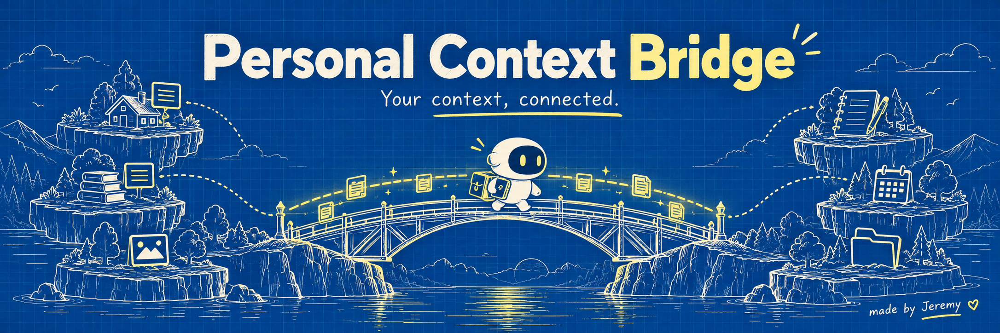

# A little bridge, made by Jeremy

The selected repository banner is **3 — Yellow constellation**: butter yellow,
cobalt ink, a cheerful star and connected notes. It is an illustration, not a
screenshot of the product or a portrait of the creator.

The title is **Personal Context Bridge**, the tagline is **Your context, connected.**,
and the creator credit is **made by Jeremy**, linked to [jeremydevv](https://github.com/jeremydevv).
Keep technical instructions direct and readable; let the art carry the playfulness.

## Five original directions

### 1. Fox archive

### 2. Glass bridge cat

### 3. Yellow constellation — selected

### 4. Botanical sprout

### 5. Blueprint robot

All five were generated using the built-in Imagegen tool. [Full prompts](assets/banners/PROMPTS.md)
are preserved for future revisions. No personal source records or private imagery
were supplied to generation.

## Repository page references

Reviewed these upstream pages for presentation patterns. The project uses its own
copy and artwork; the references are structural inspiration.

| Reference | Pattern applied here |
| --- | --- |
| [Vite](https://github.com/vitejs/vite) | Compact branded header, useful badges, concise entry points |
| [Supabase](https://github.com/supabase/supabase) | Features linked directly to their own documentation |
| [Mem0](https://github.com/mem0ai/mem0) | Wide project banner and prominent navigation |
| [Archon](https://github.com/coleam00/Archon) | Creator-friendly identity and a concrete explanation before detail |
| [Open WebUI](https://github.com/open-webui/open-webui) | Clear self-hosting context and installation entry points |

The [English-language GitHub Trending page](https://github.com/trending?spoken_language_code=en)
also listed Vite and Supabase when reviewed. Trending rankings change; this is not
a ranking or popularity claim about Personal Context Bridge.
